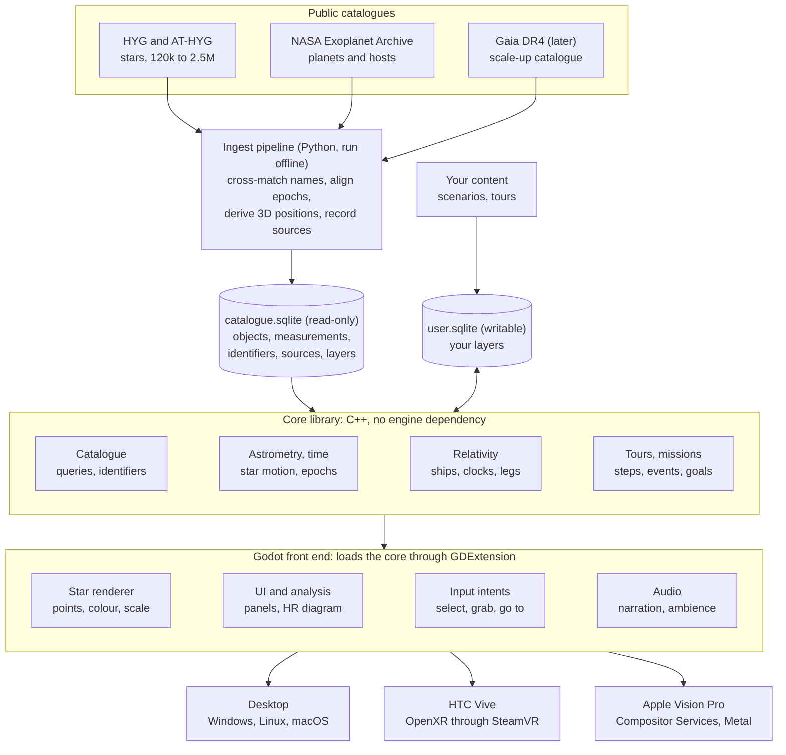

# Stellar Explorer: Architecture

Drafted 3 October 2026. Web facts were checked on that date; engine support for Vision Pro is moving quickly, so recheck before committing to it. The plan, risks and open questions are in [PLAN.md](PLAN.md).

## Summary

Build Stellar Explorer as an engine-independent core library over a SQLite catalogue, with Godot 4 as the front end for desktop, HTC Vive and Apple Vision Pro.

- **Core.** A C++ library owns the science: catalogue queries, astrometry, time propagation, relativistic trajectories, tours. It has no engine dependency and is testable on its own.
- **Data.** A Python ingest pipeline turns public catalogues into one SQLite file where every value carries its source. Fiction and user content live in separate layers and never mix with measured data.
- **Front end.** Godot renders the stars, hosts the UI and analysis views, and handles the headsets: OpenXR for the Vive, Apple's Compositor Services path for Vision Pro.
- **Biggest risk.** Godot's fully immersive Vision Pro support is new in 2026. The roadmap tests it early, and the core/front-end split keeps a native Metal shell available as the fallback.

The stack was accepted on 25 October 2026 ([ADR 0007](decisions/0007-stack-core-sqlite-godot.md)), with the core in C++ ([ADR 0008](decisions/0008-core-in-cpp.md)).

## Goals and scope

Stellar Explorer is a personal native 3D and VR exhibit of the real solar neighbourhood, built on a catalogue database that can be extended and queried. It starts at the scale of the [100,000 Stars](https://stars.chromeexperiments.com/) Chrome experiment (about 120,000 stars) and is designed so the same code grows to millions.

What v1 must do:

- **Explore real data.** Fly among stars placed, coloured and sized from catalogue values, on desktop, HTC Vive and Apple Vision Pro.
- **Show provenance.** Every object links to its source catalogue, its identifiers and its measurement uncertainties.
- **Move through time.** Run the sky forwards and backwards using proper motion and radial velocity.
- **Analyse.** Linked HR diagram, filters by distance, spectral type and magnitude, selection and measurement tools.
- **Hold exoplanets.** Planetary systems attached to their host stars, from the NASA Exoplanet Archive.
- **Be a database first.** The catalogue is a queryable store that accepts new tables, user objects and fictional overlays without code changes.
- **Simulate starships.** Ships, trajectories and relativistic time dilation as a scenario layer, so journeys from Alastair Reynolds' books can be modelled against the real star map.
- **Guide and reward.** Scripted tours, plus optional game mechanics for discovery.

Out of scope for v1, but not designed out: the full Gaia catalogue (1.8 billion sources), galaxies beyond the Milky Way, planetary surfaces, and multi-user sessions.

## Prior art

Three existing projects mark out the space: one shows the experience to match, two show how scientific tools solve the scale problem.

| Project | What it is | Borrow | Where Stellar Explorer differs |
| --- | --- | --- | --- |
| [100,000 Stars](https://web.dev/case-studies/100000stars) | 2012 three.js experiment. 119,617 stars from the HYG database, drawn as GPU particles coloured by colour index. | The feel: smooth zoom from the Sun to the galaxy, labels, music, a short tour. | Its author calls it an artist's interpretation. It used 1 unit = 1 light-year in single precision and needed workarounds for the resulting precision errors. |
| [Gaia Sky](https://gaiasky.space/) | Open-source desktop and VR astronomy platform, version 3.8.0. Gaia DR3 catalogues, proper motion and radial velocity, Python scripting, OpenXR. | Magnitude-ordered level-of-detail catalogues, 6D star motion, a scripting API for tours. | VR runs on Windows and Linux only. Its [VR notes](https://gaia.ari.uni-heidelberg.de/gaiasky/docs/3.7.3/Gaia-sky-vr.html) say level-of-detail catalogues perform poorly in a headset. No Vision Pro. |
| [OpenSpace](https://www.openspaceproject.com/) | MIT-licensed visualisation used by planetariums and museums, version 0.22.0. Mission trajectories, exoplanet and galaxy catalogues, dome projection. | Exhibit thinking: touch kiosks, synchronised displays, spacecraft trajectories as first-class objects. | Built for domes and installations, not personal headsets. No fiction or game layer. |

Gaia Sky is the closest in science and is worth installing as a reference for how real catalogue data should look and behave.

## Stack recommendation

Godot 4 is the pick: it is free and open source, has OpenXR built in for the Vive, and gained an Apple-backed path to fully immersive Vision Pro apps in 2026. The deciding constraint is that [Vision Pro does not support OpenXR](https://www.uploadvr.com/godot-now-supports-visionos-apple-vision-pro/), so every option needs two XR back ends, and only an engine hides that.

| Option | Vive (OpenXR) | Vision Pro, fully immersive | Cost and licence | Verdict |
| --- | --- | --- | --- | --- |
| **Godot 4.6** | Built in, [OpenXR 1.1](https://ziva.sh/blogs/godot-vr) | Windowed export since [4.5](https://godotengine.org/releases/4.5/). Apple's [visionOS 27 engine plugins](https://developer.apple.com/wwdc26/guides/visionos/) add Compositor Services immersive rendering, spatial audio and PS VR2 Sense controllers | Free, MIT | **Recommended.** Newest on Vision Pro, so test it first |
| Unity 6 | Mature | Most established. [Requires Unity Pro, Enterprise or Industry](https://docs.unity3d.com/Manual/visionOS.html) for immersive apps | Paid subscription | Fallback if the licence and a closed engine are acceptable |
| Unreal 5 | Mature | Native since 5.4. Sources disagree on whether it is still [experimental](https://www.xrvdc.org/news/unreal-engine-vision-pro-getting-started/) or [shipping in 5.7](https://www.strayspark.studio/blog/apple-vision-pro-visionos-indie-game-development-2026) | Royalty terms | Too heavy for a data-driven point-cloud app |
| Custom renderer | Own OpenXR integration | Compositor Services directly; its APIs have [C equivalents](https://developer.apple.com/videos/play/wwdc2025/294/) | Free | Most control, but the UI, input and tooling must be written too. Keep it as the Vision Pro fallback only |
| Bevy (Rust) | [Community crate](https://lib.rs/crates/bevy_mod_openxr), pre-1.0 | No path found | Free | Not ready |

Three points shape how Godot is used:

- **Godot is the shell, not the brain.** All science lives in the core library, loaded through GDExtension. If the front end ever changes, the core, the database and the tours carry over untouched.
- **Stock Godot builds only.** Godot's [large world coordinates](https://docs.godotengine.org/en/stable/tutorials/physics/large_world_coordinates.html) need a custom double-precision engine build. The core avoids that by doing 64-bit maths itself and handing the renderer camera-relative 32-bit positions.
- **A Mac can stand in for the headset.** macOS 26 can [render and stream immersive content to Vision Pro](https://developer.apple.com/videos/play/wwdc2025/294/), which gives a second route if on-device performance falls short.

A browser build (WebXR) would reach both headsets with one code base, but the requirement is a native app, and native gives better control of precision, frame timing and local data.

## System architecture

Data is prepared offline, the core library turns it into answers, and Godot only draws and listens.



Read it top to bottom: catalogues are built into a read-only database, the core reads that plus the writable layers, and the front end asks the core for everything it shows.

The boundary that matters is between the core and Godot. The front end may call only a small interface:

- **Query.** Run a filter or SQL statement; get object ids and a packed buffer of positions, velocities, magnitudes and colours.
- **Clock.** Set or advance master time; read ship states at that time.
- **Pick.** Cast a ray; get the nearest object and its provenance record.
- **Plan.** Solve a course between two objects for a given acceleration profile.
- **Play.** Step a tour or mission; receive events.

Because the core has no engine dependency, it gets ordinary unit tests: known star distances, known relativistic travel times, known sky positions at a given date.

### Repository layout

| Path | Holds |
| --- | --- |
| `docs/` | This documentation |
| `src/pipeline/` | Python ingest: public catalogues to `catalogue.sqlite` |
| `src/core/` | Core library and its tests |
| `src/app/` | Godot project |
| `tours/` | Tour files |
| `scenarios/` | A neutral example scenario; `scenarios/private/` is a separate private repository, git-ignored here |
| `scripts/` | Repository tooling: documentation link check, version fields |
| `data/` | Downloaded catalogues and built databases; git-ignored |
| `release_notes/` | One user-facing file per release |

Only `docs/`, `src/pipeline/`, `scripts/` and `release_notes/` exist so far; the rest appear with the phase that needs them.

## Data and database

The catalogue is one SQLite file, built offline by a Python pipeline and opened read-only by the app, with a second writable file for user content. SQLite runs unchanged on Windows, Linux, macOS and visionOS, and can be interrogated with any SQL tool.

### Sources for v1

| Source | Content | Size | Notes |
| --- | --- | --- | --- |
| [HYG 4.4](https://codeberg.org/astronexus/hyg) | Hipparcos, Yale Bright Star and Gliese catalogues merged. Positions, proper motion, radial velocity, 3D coordinates and velocities, spectral type, colour index, luminosity | 119,614 stars | The same lineage as the Chrome experiment. Names, photometry and radial velocities come from here. CC BY-SA 4.0 |
| [Hipparcos New Reduction](https://cdsarc.cds.unistra.fr/viz-bin/cat/I/311) | Positions, parallaxes and proper motions with uncertainties (van Leeuwen 2007) | 117,955 stars | Astrometry for the HYG stars it covers ([ADR 0011](decisions/0011-astrometry-from-hipparcos.md)) |
| [AT-HYG 3.2](https://astronexus.com/projects/at-hyg) | Tycho-2 with Gaia distances and velocities | 2.55 million stars; subsets from 119,000 to 871,000 | First scale-up step, same field layout. CC BY-SA 4.0 |
| [NASA Exoplanet Archive](https://exoplanetarchive.ipac.caltech.edu/) | Confirmed planets and host stars, via the [TAP service](https://exoplanetarchive.ipac.caltech.edu/docs/TAP/usingTAP.html) tables `ps` and `pscomppars` | 6,451 confirmed planets on 25 October 2026 | Re-run the ingest to refresh |
| [Gaia DR4](https://www.cosmos.esa.int/web/gaia/release) | Next Gaia release, 66 months of data | Due 2 December 2026 | Target for the later scale-up, not v1 |

CC BY-SA 4.0 means a redistributed database derived from HYG must carry attribution and the same licence. The code is unaffected.

The pipeline, the schema, the rules for choosing between sources, and what was found in the sources are in [DATA-MODEL.md](DATA-MODEL.md).

### Schema principles

- **Objects and measurements are separate.** An `object` row is a thing (star, planet, system, ship, station). A measurement row is one catalogue's claim about it, with value, uncertainty, epoch and a `source_id`.
- **Provenance is a table, not a comment.** `source` holds catalogue name, version, licence, URL, citation and retrieval date. The info panel in the app reads straight from it.
- **Identifiers are many-to-one.** An `identifier` table maps HIP, HD, Gliese, Gaia, Bayer and proper names to one object, so "Epsilon Eridani", "HIP 16537" and "Ran" all resolve to the same row.
- **Derived values are marked as derived.** Cartesian position and velocity, absolute magnitude and temperature are computed by the pipeline and stored with the formula version, so they can be rebuilt.
- **Layers keep fact and fiction apart.** Every row belongs to a `layer` of kind `observed`, `hypothetical` or `fiction`. A story overlay is a fiction layer attached to real host stars; switching it off leaves pure catalogue data.
- **Extension needs no code change.** A new catalogue is a new source plus measurement rows. A wholly new kind of data is a new table registered in a `dataset` table that tells the app how to draw and label it.

### Interrogation

- A read-only SQL console in the desktop build, with results shown as a table and as a highlighted selection in the 3D view.
- Saved queries become named filters ("G dwarfs within 15 pc with known planets") usable in tours and missions.
- The same file opens in DBeaver, the `sqlite3` shell or a Python notebook for work outside the app.

SQLite is the right size up to a few million stars. For the full Gaia stage the bulk catalogue moves to Parquet files or PostgreSQL on a workstation, and the app keeps SQLite for metadata, overlays and the stars it has loaded.

## Rendering and scale

At 120,000 stars the whole catalogue is one GPU buffer and one draw call; the hard problems are precision and honest brightness, not count.

- **Precision.** The core keeps positions in parsecs as 64-bit floats. Each frame it subtracts the camera position in 64-bit and sends the renderer 32-bit offsets. This is the fix for the jitter 100,000 Stars worked around, and it spans planetary orbits (1 AU is about 4.8 millionths of a parsec) to the galaxy.
- **Brightness from physics.** The shader computes each star's apparent magnitude from its absolute magnitude and its distance to the camera, then maps flux to point size and intensity through an exposure control. Fly towards a star and it brightens correctly; nothing is hand-tuned per star.
- **Colour from data.** Colour comes from the catalogue colour index or effective temperature through a blackbody lookup, not an artist's palette.
- **Scale layers.** Interstellar space, a single planetary system and (later) the galaxy are separate scenes with their own units and depth ranges, cross-faded when moving between them.
- **World scale in VR.** In a headset the universe is scaled around the viewer instead of the viewer flying through it at fixed size. Stereo depth only reads within a few metres, so a 20 parsec neighbourhood becomes a room-sized model to walk around and resize with two hands.
- **Picking.** Selection is a ray against a spatial index in the core, not GPU readback, so it behaves the same on every platform.

### Growth path

1. **120,000 stars (HYG).** One static buffer. No level of detail needed.
2. **2.5 million stars (AT-HYG).** Still fits in memory. Split into spatial chunks so the GPU skips what is off-screen.
3. **Gaia scale.** A magnitude-ordered octree: each node holds the brightest stars in its volume, children add fainter ones, and tiles stream in by how large they appear. This is Gaia Sky's approach. Its VR notes report performance trouble with streaming level of detail, so headset builds should preload a fixed budget of tiles instead of streaming during motion.

The frame-rate target is the headset's native refresh with no dropped frames: 90 Hz on the Vive. Missed frames in VR cause discomfort, so every feature is measured in the headset before it is accepted.

## Time and motion

One master clock drives everything: coordinate time in the rest frame of the solar system barycentre. Stars, planets, ships and tours all read from it, so scrubbing time moves the whole scene consistently.

- **Star motion.** Each star has a position and a 3D velocity built from proper motion, parallax and radial velocity. The shader moves it in a straight line from its catalogue epoch, so playing time costs nothing on the CPU.

```math
\mathbf{r}(t) = \mathbf{r}_0 + \mathbf{v}\,(t - t_0)
```

```math
v_{\mathrm{tan}}\,[\mathrm{km/s}] = 4.74047\;\mu\,[\mathrm{arcsec/yr}]\;d\,[\mathrm{pc}]
```

- **Missing radial velocity.** Many catalogue stars have none. They move across the sky only, and the info panel says so; the app does not invent a value.
- **Epochs.** Catalogues are measured at different epochs. The pipeline stores each measurement's epoch and propagates everything to one reference epoch before export.
- **Range of validity.** Straight-line motion is a good approximation over tens of thousands of years. Beyond that, stars follow curved orbits in the galaxy; the time slider shows a warning band there, and a later phase can precompute orbits offline.
- **Planets.** Exoplanet positions come from their orbital elements where the archive has them. Where elements are incomplete the orbit is drawn as schematic and labelled as such.
- **What it shows.** Constellation figures deforming over 50,000 years, close stellar passes to the Sun, and the sky as seen from another star at another date.

## Analysis views

Every analysis view is a second window onto the same selection: pick stars in one and they light up in the others.

- **HR diagram.** Absolute magnitude against colour for the stars currently loaded or filtered. Brushing a region (the white dwarfs, the giant branch) highlights those stars in 3D.
- **Filters.** Distance, apparent and absolute magnitude, spectral class, has-planets, catalogue of origin, data quality. Filters are SQL underneath and can be saved.
- **Info panel.** Identifiers, measured values with uncertainties, derived values, and the source of each line with a link to the catalogue.
- **Measurement.** Distance and light-travel time between any two objects, angular separation as seen from a third, and nearest-neighbour lists.
- **Sky from here.** The view from any star as a planetarium sky, with the Sun marked.
- **Uncertainty display.** Optional distance error bars drawn along the line of sight from Earth, which shows at a glance how position quality falls off with distance.

On desktop these are docked panels. In a headset they are floating panels in the space around the viewer, with the HR diagram doubling as a hand-held selection tool.

## Starships and relativity

A ship is an object with a worldline: an ordered list of legs (accelerate, coast, decelerate, wait at a star), each solved exactly with special relativity. Given any moment on the master clock, the core returns the ship's position, speed and on-board time, so ships scrub with the time slider like everything else.

### Three clocks

- **Master time.** Coordinate time in the Sun's rest frame. The stars' motion and the scenario calendar run on it.
- **Ship time.** Proper time on board, which runs slow by the Lorentz factor.
- **Seen time.** What an observer knows, delayed by light travel. A departure from one system is not news at another until its light arrives.

For a leg at constant proper acceleration $a$, starting from rest, with ship time $\tau$:

```math
x(\tau) = \frac{c^2}{a}\left(\cosh\frac{a\tau}{c} - 1\right), \qquad t(\tau) = \frac{c}{a}\sinh\frac{a\tau}{c}, \qquad \gamma(\tau) = \cosh\frac{a\tau}{c}
```

Worked check: a 10.5 light-year trip at a constant 1 g, accelerating to the midpoint and then decelerating, takes 12.3 years on the master clock and 4.9 years on board, peaking at 98.8% of light speed. This is the first unit test for the relativity module.

### What it adds to the exhibit

- **Course plotter.** Choose origin, destination, acceleration and cruise speed. The core returns arrival dates on both clocks and aims at where the destination star will be on arrival, not where it is at departure.
- **View from the bridge.** The star shader applies relativistic aberration and Doppler shift for the ship's velocity: stars crowd towards the direction of travel and shift blue ahead, red behind.
- **Spacetime diagram.** A distance-against-time chart of worldlines and light cones, linked to the 3D view. It shows who can know what, and when.
- **Light-front spheres.** An event's news drawn as a sphere expanding at light speed through the star map.

### Scenarios

A scenario is a data file in a fiction layer: named places attached to real stars, ships with their legs, and dated events on either clock. This is the mechanism for the Alastair Reynolds simulator. His Revelation Space stories are built on slower-than-light travel between nearby real stars (Epsilon Eridani, Delta Pavonis and 61 Cygni among them; from memory, to be checked against the books), so ship time against world time is the heart of the plots.

Scenario content is private data. The public repository carries the mechanism and a neutral example; book-specific names and events live in a separate private repository checked out into `scenarios/private/`, which is git-ignored ([ADR 0010](decisions/0010-public-repository-private-scenarios.md)).

## Tours and gamification

Tours and game mechanics are both data played over the same engine: a tour drives the camera and clock, a mission watches what the user does. Neither touches the science layer, and exhibit mode can run with both switched off.

### Guided tours

- A tour is a timeline of steps: camera target and world scale, master time, active filters, highlighted objects, and narration as text or audio.
- Tours are plain files in the repository, so they can be written, reviewed and versioned like code.
- The visitor can pause at any step, explore freely, and resume.

### Game layer

- **Discovery log.** A passport of things found: each spectral class, the nearest 50 stars, every star with a known planet inside 10 parsecs.
- **Missions.** Goals expressed as saved queries plus a condition, for example "find a white dwarf within 20 light-years" or "identify the Sun from Sirius".
- **Navigation challenges.** Plot a course that arrives before a rival ship, or within a ship-time budget. These use the relativity core directly, so the physics is the puzzle.
- **Scenario play.** Step through a story scenario as a captain's log, with decisions that branch the worldline.
- **Progression unlocks tools, not data.** New instruments (the HR diagram, the spacetime chart) can be earned in game mode, but all data is always visible in exhibit mode.

To support this, the core publishes events (object visited, selection made, course plotted, time changed) that the mission system subscribes to.

## VR targets

The two headsets differ in runtime, input and computing power, so the app talks to them through one set of interaction intents and two thin platform layers.

| | HTC Vive | Apple Vision Pro |
| --- | --- | --- |
| Runtime | OpenXR through SteamVR, on a Windows or Linux PC | visionOS Compositor Services with Metal; no OpenXR |
| Computing | The PC's graphics card | The headset's own chip, or a Mac streaming to it |
| Primary input | Two tracked wand controllers | Eyes and hand pinches |
| Optional input | | [PS VR2 Sense controllers](https://www.uploadvr.com/visionos-26-out-now-apple-vision-pro/), tracked in six degrees of freedom since visionOS 26 |
| Build machine | Any | A Mac with Xcode |
| Extras | Room-scale tracking | [Progressive immersion](https://developer.apple.com/videos/play/wwdc2025/294/) on the Digital Crown, foveated rendering with adjustable render quality |

### One interaction model

Features are written against intents, and each platform maps its input to them:

- **Point and select.** Wand ray and trigger; look and pinch; mouse click.
- **Grab the world.** One hand drags the star field; two hands scale and rotate it. This works the same with wands and bare hands and is the main way to travel.
- **Go to.** Select an object and confirm; the world eases to centre on it with a short fade.
- **Time.** A wrist or panel dial scrubs the master clock.
- **Panels.** Info, HR diagram and filters as floating panels that can be pinned in space.

### Platform cautions

- **Gaze on Vision Pro.** In a Metal app the system draws the look-at highlight itself through tracking areas, limited to [255 objects](https://developer.apple.com/videos/play/wwdc2025/294/). Register only labelled or nearby stars; selection of any star still works at the pinch.
- **Comfort.** Move the world, not the viewer's body. No smooth artificial acceleration; use grabs, eases and fades.
- **Bright points on black.** A star field is the hardest case for headset optics and displays. Tune star size and exposure per headset, in the headset.
- **Performance.** The Vive build can afford more stars and effects than the standalone Vision Pro build. The star budget is a per-platform setting from day one.

## Sources

Pages opened on 3 October 2026.

- [Making 100,000 Stars](https://web.dev/case-studies/100000stars), web.dev case study
- [Gaia Sky](https://gaiasky.space/) and its [VR documentation](https://gaia.ari.uni-heidelberg.de/gaiasky/docs/3.7.3/Gaia-sky-vr.html)
- [OpenSpace](https://www.openspaceproject.com/)
- [HYG database](https://astronexus.com/projects/hyg) and [AT-HYG database](https://astronexus.com/projects/at-hyg), Astronexus; HYG releases are now on [Codeberg](https://codeberg.org/astronexus/hyg) (checked 25 October 2026)
- [NASA Exoplanet Archive](https://exoplanetarchive.ipac.caltech.edu/) and its [TAP guide](https://exoplanetarchive.ipac.caltech.edu/docs/TAP/usingTAP.html)
- [Gaia data release schedule](https://www.cosmos.esa.int/web/gaia/release), ESA
- [Godot 4.5 release notes](https://godotengine.org/releases/4.5/) and [Godot large world coordinates](https://docs.godotengine.org/en/stable/tutorials/physics/large_world_coordinates.html)
- [Godot VR status in 2026](https://ziva.sh/blogs/godot-vr), Ziva
- [Godot now supports visionOS](https://www.uploadvr.com/godot-now-supports-visionos-apple-vision-pro/), UploadVR
- [WWDC26 visionOS guide](https://developer.apple.com/wwdc26/guides/visionos/), Apple
- [What's new in Metal rendering for immersive apps](https://developer.apple.com/videos/play/wwdc2025/294/), Apple WWDC25
- [visionOS 26 release coverage](https://www.uploadvr.com/visionos-26-out-now-apple-vision-pro/), UploadVR
- [Unity manual: visionOS](https://docs.unity3d.com/Manual/visionOS.html)
- [Unreal Engine on Vision Pro](https://www.xrvdc.org/news/unreal-engine-vision-pro-getting-started/), XR VisionDevCamp, and [Vision Pro indie development in 2026](https://www.strayspark.studio/blog/apple-vision-pro-visionos-indie-game-development-2026), StraySpark
- [bevy_mod_openxr](https://lib.rs/crates/bevy_mod_openxr), Lib.rs
- [godot-rust crate documentation](https://docs.rs/godot) and its [visionOS pull request](https://github.com/godot-rust/gdext/pull/1696)

The relativity formulas are standard special relativity; the worked figures were computed for this document. The star-motion validity range and the Revelation Space star names are from general knowledge, not from a page opened on that date.
